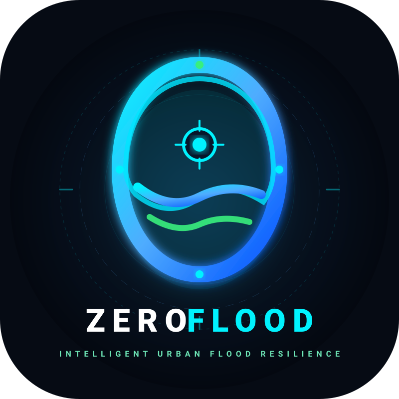

<div align="center">



# 🌊 ZeroFlood (FloodWheel)
### Real-Time Urban Flood Depth Intelligence from Municipal Traffic Cameras

**"Zero Flooded Streets • Zero Blind Spots • Zero Hardware Cost"**

[](LICENSE)
[](https://www.python.org/)
[](https://fastapi.tiangolo.com/)
[-black.svg)](https://nextjs.org/)
[-4285F4.svg)](https://ai.google.dev/)
[](docker-compose.yml)

</div>

---

## 📌 Tổng Quan Dự Án (Project Overview)

**FloodWheel** (phát triển bởi **Team ZeroFlood**) là nền tảng đo lường và cảnh báo ngập lụt đô thị theo thời gian thực sử dụng trí tuệ nhân tạo đa phương thức (**Google Gemini Multimodal Vision**). Thay vì phụ thuộc vào các cảm biến thuỷ văn ngầm đắt đỏ, dễ tắc nghẽn bởi rác thải đô thị, **FloodWheel** tận dụng trực tiếp mạng lưới camera giám sát giao thông công cộng có sẵn để đo lường độ sâu ngập (centimet) với **chi phí phần cứng bổ sung bằng 0**.

Hệ thống áp dụng phương pháp luận **VLRDR (Visual Landmark-Referenced Depth Ratio)**: đo lường tỷ lệ ngập của các mốc vật lý đô thị (bánh xe máy ~50cm, ống xả ~35cm, vỉa hè ~15-20cm) để tính toán độ sâu ngập chính xác và đưa ra khuyến nghị an toàn cho từng loại phương tiện giao thông.

---

## ✨ Tính Năng Nổi Bật (Key Features)

- 🔍 **Đo mực nước chuẩn xác (VLRDR Depth Sensing):** Phân tích hình ảnh camera để ước tính độ sâu ngập (cm) và phân cấp 5 mức độ nguy hiểm (Level 0 – Level 4).
- 📹 **Tích hợp ~800 Camera Giao thông TP.HCM:** Thu thập tự động từ Cổng thông tin giao thông (`giaothong.hochiminhcity.gov.vn`) với cơ chế quản lý session `.VDMS`, Redis cache (TTL 10s), và dự phòng 2 tầng.
- 🗺️ **Bản đồ tương tác & Heatmap thời gian thực:** Trực quan hoá các điểm ngập trên nền tảng bản đồ số Leaflet/MapLibre, hiển thị cảnh báo theo màu sắc trực quan.
- 🚦 **Đánh giá rủi ro theo phương tiện & Điều hướng an toàn:** Cảnh báo nguy cơ chết máy cho xe máy (ống xả ngập) và xe sedan trước khi đi vào điểm nóng.
- ⚡ **Background Queue & Smart Quota Optimization:** Hàng đợi phân tích tự động chạy ngầm, tự động xoay vòng API Keys Gemini, tránh vượt ngưỡng Rate Limit (15 RPM free tier).
- 📊 **Admin Dashboard & Telemetry:** Theo dõi trạng thái hoạt động của camera, tỷ lệ phản hồi, giám sát hàng đợi và hiệu suất AI.

---

## 🏷️ Thang Đo Mực Nước VLRDR (Depth Hazard Classification)

| Cấp độ | Tên cảnh báo | Độ sâu (cm) | Mốc tham chiếu thị giác (Visual Landmarks) | Khuyến nghị di chuyển |
| :---: | :--- | :---: | :--- | :--- |
| **Level 0** | **Khô ráo (Dry)** | `0 cm` | Mặt đường khô, vỉa hè và bánh xe nhìn rõ | Mọi phương tiện lưu thông bình thường |
| **Level 1** | **Ngập nhẹ (Minor)** | `< 15 cm` | Nước mấp mé mép bánh xe máy (< 1/3 bánh) | Lưu thông bình thường |
| **Level 2** | **Ngập vừa (Moderate)** | `15 – 30 cm` | Nước ngập 1/3 đến 1/2 bánh xe, xấp xỉ mép bô | Xe máy đi chậm, giữ đều ga; xe gầm cao an toàn |
| **Level 3** | **Ngập sâu (Critical)** | `30 – 50 cm` | Ngập quá nửa bánh xe, ống xả chìm hoàn toàn | **Nguy cơ chết máy cao!** Xe máy và sedan không nên đi qua |
| **Level 4** | **Ngập cực đoan (Severe)** | `> 50 cm` | Nước ngập yên xe máy, ngập sàn ô tô con | **Đình trệ hoàn toàn!** Cấm tất cả phương tiện dân sự |

---

## 🏗️ Kiến Trúc Hệ Thống (System Architecture)

```text
+-----------------------------------------------------------------------------------+
|                                Next.js 14 Frontend                                |
|          (Live Map, Camera Catalog, 1-Click AI Analysis, Admin Dashboard)         |
+-----------------------------------------------------------------------------------+
                       |                                         |
         (GET /api/v1/cameras, /snapshot)                (POST /analyze, /flood)
                       v                                         v
+----------------------------------------------+   +--------------------------------+
|          Camera-Backend (:8001)              |   |       Core Backend (:8000)     |
| - HCMC Municipal Portal Scraper (.VDMS)     |<--| - CameraServiceClient Adapter   |
| - Redis Snapshot Cache (TTL: 10s)            |   | - Image Pre-filter & Validator |
| - 2-Tier Fallback (Disk -> Synthetic CCTV)   |   | - GeminiClient (Lock & Pacing) |
+----------------------------------------------+   | - VLRDR Prompt & Model Engine  |
                                                   | - FloodQueue & Key Rotation    |
                                                   +--------------------------------+
                                                                 |
                                                                 v
                                                   +--------------------------------+
                                                   |   PostgreSQL/PostGIS & Redis   |
                                                   +--------------------------------+
```

---

## 🛠️ Công Nghệ Sử Dụng (Tech Stack)

* **AI & Vision:** Google Gemini Multimodal Vision API (`gemini-3.5-flash-lite`), VLRDR Depth Engine.
* **Core Backend:** Python 3.12+, FastAPI (:8000), SQLAlchemy, AsyncPG, Pydantic v2.
* **Camera Microservice:** FastAPI (:8001), httpx, Redis cache, AjaxPro/VDMS parser.
* **Database & Cache:** PostgreSQL 16 + PostGIS 3.4, Redis 7 (Alpine).
* **Frontend:** Next.js 14 (Pages router), React, Tailwind CSS, Leaflet / MapLibre GIS.
* **DevOps:** Docker, Docker Compose, GNU Make.

---

## 🚀 Hướng Dẫn Cài Đặt & Chạy (Quick Start)

### 1. Yêu cầu tiên quyết
* [Docker](https://docs.docker.com/get-docker/) & [Docker Compose](https://docs.docker.com/compose/)
* [Google Gemini API Key](https://aistudio.google.com/)

### 2. Thiết lập biến môi trường
Tạo file `.env` từ file mẫu:
```bash
cp .env.example .env
```
Mở file `.env` và điền khoá API Gemini của bạn:
```env
GEMINI_API_KEY=your_gemini_api_key_here
```

### 3. Khởi động hệ thống bằng Docker Compose

```bash
# Khởi động toàn bộ dịch vụ (Frontend, Backend, Camera Backend, Postgres, Redis)
make dev
# Hoặc chạy nền
make up
```

Sau khi các container khởi động hoàn tất:
| Dịch vụ | URL truy cập | Ghi chú |
| :--- | :--- | :--- |
| **Frontend Web App** | [http://localhost:3000](http://localhost:3000) | Giao diện bản đồ & phân tích camera |
| **Core Backend Docs** | [http://localhost:8000/docs](http://localhost:8000/docs) | Swagger OpenAPI core AI & flood data |
| **Camera Microservice Docs** | [http://localhost:8001/docs](http://localhost:8001/docs) | Swagger OpenAPI camera ingest & snapshots |
| **Admin Dashboard** | [http://localhost:3000/admin](http://localhost:3000/admin) | Quản trị camera & background queue |

---

## 💻 Lệnh Thao Tác Nhanh (Makefile Commands)

Dự án cung cấp sẵn Makefile để tiện quản lý:
```bash
make dev           # Khởi động toàn bộ dịch vụ kèm live-reload
make up            # Chạy dịch vụ ở chế độ background (-d)
make down          # Dừng và dọn dẹp các container
make restart       # Khởi động lại tất cả container
make logs          # Xem log trực tiếp của toàn bộ hệ thống
make test          # Chạy test suite backend
make check-lines   # Kiểm tra tiêu chuẩn độ dài file (<= 250 dòng/file)
make clean         # Dọn dẹp cache (__pycache__, .next)
```

---

## 📁 Cấu Trúc Dự Án (Repository Structure)

```text
FloodWheel/
├── backend/                  # Core FastAPI Backend (Port 8000)
│   ├── app/
│   │   ├── api/ & routers/   # API routing & dependencies
│   │   ├── core/ & db/       # Config, database connection & migrations
│   │   ├── models/ & schemas/# SQLAlchemy models & Pydantic schemas
│   │   └── services/         # Gemini AI, VLRDR logic, background queue
│   └── tests/                # Unit & integration tests
├── camera-backend/           # Camera Ingestion Microservice (Port 8001)
│   ├── app/
│   │   ├── providers/        # HCMC CCTV provider (.VDMS)
│   │   └── services/         # Redis snapshot cache & catalog sync
├── frontend/                 # Next.js 14 Web Application (Port 3000)
│   ├── components/           # UI components, Leaflet map, Camera modals
│   ├── hooks/                # Custom React hooks
│   └── pages/                # App routing (/cameras, /admin, ...)
├── docs/                     # Tài liệu kiến trúc chuyên sâu & assets
│   ├── assets/               # Logo SVG & JPG
│   └── camera_ai_analysis_flow.md # Chi tiết luồng kéo ảnh & phân tích AI
├── docker-compose.yml        # Orchestration cho toàn bộ microservices
├── Makefile                  # Phím tắt điều khiển môi trường dev/test
└── AGENTS.md                 # Quy tắc mã nguồn & giới hạn độ dài file (<= 250 lines)
```

---

## 👥 Về Đội Ngũ (Team ZeroFlood)

- **Tên đội:** ZeroFlood (`zeroflood`)
- **Dự án:** FloodWheel — Real-time Urban Flood Depth Intelligence
- **Triết lý:** *ZERO Damage • ZERO Blind Spots • ZERO Extra Hardware*
