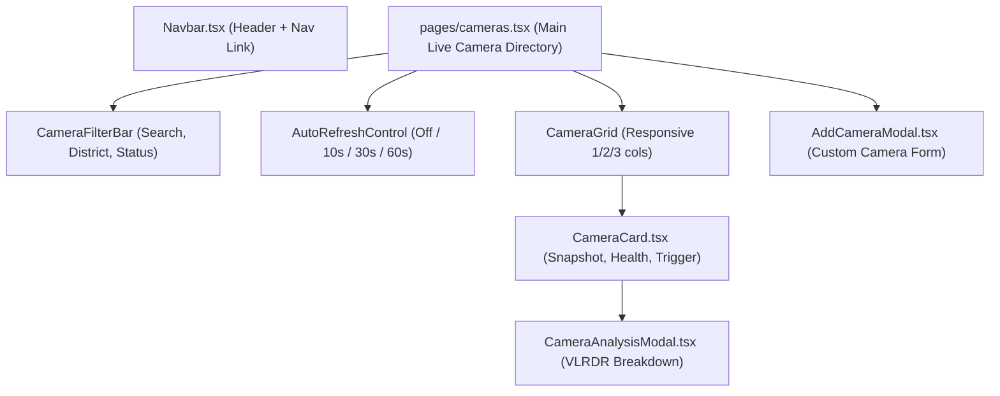

# Stage 6: Application Design — Components Design

## 1. UI Component Architecture

## 2. Component Specifications

### `LiveCamerasPage` (`frontend/pages/cameras.tsx`)
- **State**:
  - `cameras: Camera[]`: Full list fetched from `/api/v1/cameras`.
  - `selectedDistrict: string`: Filter value (`all`, `Binh Thanh`, `District 1`, `Thu Duc City`).
  - `searchQuery: string`: Text search for camera name or street.
  - `refreshInterval: number`: Interval in seconds (0 = off, 10, 30, 60).
  - `analyzingCameraId: string | null`: Camera currently undergoing inference.
  - `analysisResult: AnalysisResult | null`: Result payload to show in modal.
  - `isAddModalOpen: boolean`: Toggle for custom camera registration.
- **Effects**:
  - `useEffect` for periodic ticker timer: updates `cacheBuster` timestamp every `refreshInterval` seconds when `document.hidden === false`.

### `CameraCard` (`frontend/components/CameraCard.tsx`)
- **Props**:
  - `camera: Camera`
  - `cacheBuster: number`
  - `onAnalyze: (camera: Camera) => Promise<void>`
  - `isAnalyzing: boolean`
- **Visual Elements**:
  - Snapshot image frame: `` with fallback placeholder on error.
  - Camera Name & Location with map pin icon.
  - Angle badge (`Street Level`, `Elevated`, `Overhead`).
  - Status badge: Green for `ONLINE`, Yellow for `DEGRADED`, Red for `OFFLINE`.
  - "📸 Capture & Analyze" button: Animated pulse when analyzing.
  - Quick refresh button.

### `CameraAnalysisModal` (`frontend/components/CameraAnalysisModal.tsx`)
- **Props**:
  - `isOpen: boolean`
  - `onClose: () => void`
  - `result: AnalysisResult | null`
  - `camera: Camera | null`
- **Visual Elements**:
  - Left column: Captured camera frame image with watermark badge.
  - Right column:
    - Level badge (`Level 0` to `Level 5`) with color styling.
    - Water depth range: `{depth_cm_min} - {depth_cm_max} cm`.
    - Confidence gauge: `{confidence_score * 100}%` confidence.
    - Identified Visual Landmarks (pills).
    - Vehicle Passability Icons: Two-wheelers, Sedans, SUVs, Trucks with Check/Cross icons.
    - Gemini VLRDR Reasoning narrative.
    - Public safety advisory banner.

### `AddCameraModal` (`frontend/components/AddCameraModal.tsx`)
- **Fields**: ID, Name, Location, Latitude, Longitude, Angle (`street_level`, `elevated`, `overhead`), Stream URL, Zone ID.
- **Actions**: "Test Stream", "Cancel", "Save Camera".
