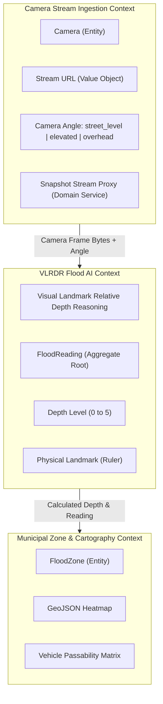

# Stage 6: Application Design — Context Map

## Bounded Contexts & Ubiquitous Language

### Ubiquitous Language Definitions
- **Public Traffic Camera**: An authorized CCTV node deployed at an urban street junction publishing periodic image snapshots or video streams.
- **Snapshot Proxy**: Backend intermediary ensuring secure, CORS-compliant, cached delivery of camera frames to the web frontend.
- **Instant Snapshot Analysis**: Operator-initiated invocation of Gemini Vision VLRDR on the latest captured camera frame.
- **Visual Landmark Relative Depth Reasoning (VLRDR)**: Multimodal reasoning utilizing known physical object dimensions (motorcycle tires ~50cm, exhaust pipes ~30cm, curbs ~15cm) to estimate water depth without embedded physical sensors.
- **Passability Matrix**: Assessment of whether 2-wheelers, low sedans, high-clearance SUVs, and trucks can safely traverse the flooded road.
