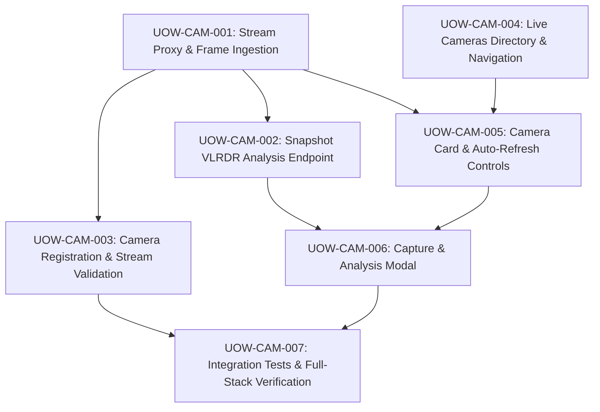

# Stage 7: Units Generation — Dependency & Execution DAG

## Execution Sequence & Dependency Graph

## Batch Rollout Plan
- **Batch 1 (Backend Core)**: `UOW-CAM-001` (Proxy Service) → `UOW-CAM-002` (Analyze Endpoint) → `UOW-CAM-003` (Registration API).
- **Batch 2 (Frontend Interface)**: `UOW-CAM-004` (Directory & Nav) → `UOW-CAM-005` (Camera Card & Viewer) → `UOW-CAM-006` (Analysis Modal).
- **Batch 3 (Verification)**: `UOW-CAM-007` (Automated Tests & System Verification).
