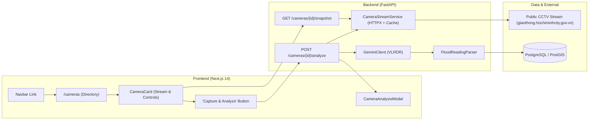
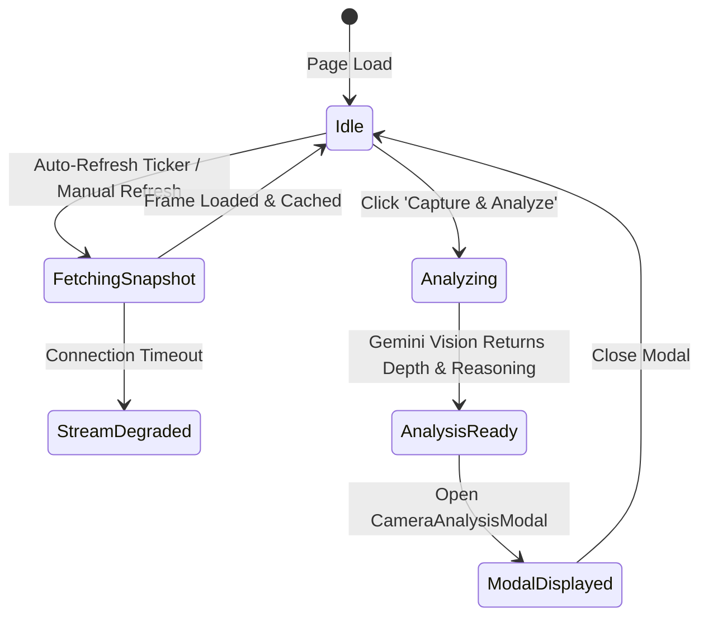

# ★ Detailed Design Baseline — Public CCTV Camera Streaming & One-Click Flood Analysis

## 1. System Context & Feature Scope
This baseline defines the comprehensive architecture and specifications for integrating public traffic CCTV cameras into FloodWheel, enabling live/later camera viewing, configurable auto-refreshing, and one-click camera frame capture with instant Gemini Vision VLRDR flood depth analysis.



---

## 2. Component Ownership & Responsibilities

| Component / Service | Location | Core Responsibilities |
|---|---|---|
| `LiveCamerasPage` | `frontend/pages/cameras.tsx` | Main camera portal, responsive grid, district filtering, auto-refresh interval select. |
| `CameraCard` | `frontend/components/CameraCard.tsx` | Displays proxied camera frame, status badge, camera angle, manual refresh, and "Capture & Analyze" trigger. |
| `CameraAnalysisModal` | `frontend/components/CameraAnalysisModal.tsx` | Interactive modal showing captured frame, depth level (0-5), centimeter range, landmark chips, passability matrix, reasoning narrative. |
| `AddCameraModal` | `frontend/components/AddCameraModal.tsx` | Form modal allowing operators to register new public camera stream URLs with instant connectivity test. |
| `Navbar` | `frontend/components/Navbar.tsx` | Global header containing "Live Cameras" navigation link. |
| `CameraStreamService` | `backend/app/services/camera_stream_service.py` | Asynchronous HTTPX client fetching external frames, 5s TTL memory caching, synthetic fallback generator on stream downtime. |
| `CamerasRouter` | `backend/app/routers/cameras.py` | Endpoints: `GET /cameras`, `GET /cameras/{id}/snapshot`, `POST /cameras/{id}/analyze`, `POST /cameras`. |

---

## 3. Data Contracts & REST APIs

### 3.1 `GET /api/v1/cameras/{id}/snapshot`
- **Output**: Binary image bytes (`Content-Type: image/jpeg` or `image/png`).
- **Headers**:
  - `Access-Control-Allow-Origin: *`
  - `Cache-Control: public, max-age=5`

### 3.2 `POST /api/v1/cameras/{id}/analyze`
- **Response**: `200 OK`
```json
{
  "success": true,
  "camera_id": "cam-nhc-01",
  "camera_name": "CCTV 042: Nguyen Huu Canh Flyover",
  "reading": {
    "camera_id": "cam-nhc-01",
    "flood_detected": true,
    "confidence_score": 0.88,
    "depth_level": 3,
    "depth_estimate_cm_min": 30,
    "depth_estimate_cm_max": 40,
    "reference_objects_used": [
      "Motorcycle wheel submerged 1/2 (~35cm)",
      "Sidewalk curb submerged"
    ],
    "reasoning": "Observed motorcycle wheels half submerged in standing water...",
    "alert_message": "Flood Alert Level 3 (30-40cm)! High water depth on road surface. Proceed with extreme caution."
  },
  "inference_time_ms": 482.5,
  "model_used": "gemini-3.8-flash"
}
```

---

## 4. State Transitions & UI Behavior



- **Browser Tab Backgrounding**: Auto-refresh timers pause when `document.hidden === true` to avoid background network saturation.
- **Button Debouncing**: The "Capture & Analyze" button enters a disabled spinning state during inference to prevent double submissions.

---

## 5. Security & SSRF Protection
- All user-supplied camera stream URLs are validated against private IP ranges (`127.0.0.1`, `10.0.0.0/8`, `172.16.0.0/12`, `192.168.0.0/16`, `localhost`) to block Server-Side Request Forgery.
- External requests enforce a strict 5-second connect/read timeout.

---

## 6. Requirements Traceability Matrix (RTM)

| Requirement | Description | Deliverable Units | Test / Verification |
|---|---|---|---|
| **FR-CAM-01** | Public Camera Directory & Filtering | `UOW-CAM-004` | Filter by district and status in UI |
| **FR-CAM-02** | Live Snapshot Ingestion & Asynchronous Proxy | `UOW-CAM-001` | `GET /cameras/{id}/snapshot` returns binary JPEG |
| **FR-CAM-03** | Live Feed Refresh Controls | `UOW-CAM-005` | Auto-refresh interval ticker & background pause |
| **FR-CAM-04** | One-Click Camera Snapshot AI Analysis | `UOW-CAM-002`, `UOW-CAM-006` | `POST /cameras/{id}/analyze` returns VLRDR depth |
| **FR-CAM-05** | Detailed AI Analysis Modal | `UOW-CAM-006` | Modal renders depth gauge, landmarks, passability |
| **FR-CAM-06** | Custom Camera Registration | `UOW-CAM-003` | `POST /cameras` with URL verification |
| **NFR-CAM-01** | Sub-150ms Proxy & Sub-1.5s AI Inference | `UOW-CAM-001`, `UOW-CAM-002` | Latency benchmarking |
| **NFR-CAM-02** | Fault Tolerance on Stream Timeout | `UOW-CAM-001` | Synthetic fallback frame on downtime |
| **NFR-CAM-03** | 5s TTL Cache & Bandwidth Optimization | `UOW-CAM-001` | Memory cache hits on rapid calls |
| **NFR-CAM-04** | SSRF URL Validation | `UOW-CAM-003` | Rejection of local/internal IP streams |
