# Stage 5: Workflow Planning — Execution Plan

## 1. Overview & Strategy
This plan outlines the sequential rollout of public camera stream ingestion, live snapshot viewing, and one-click Gemini Vision VLRDR flood analysis across 3 Construction Phases and 7 Units of Work.

```mermaid
flowchart LR
    subgraph Phase1 ["Phase 1: Backend Snapshot & Analysis Engine"]
        UOW01["UOW-CAM-001: Stream Proxy & Frame Ingestion"]
        UOW02["UOW-CAM-002: Snapshot VLRDR Analysis Endpoint"]
        UOW03["UOW-CAM-003: Camera Registration & Stream Validation"]
    end

    subgraph Phase2 ["Phase 2: Live Cameras UI & Instant Analysis"]
        UOW04["UOW-CAM-004: Live Cameras Directory & Navigation"]
        UOW05["UOW-CAM-005: Camera Card & Auto-Refresh Viewer"]
        UOW06["UOW-CAM-006: Instant Capture & Analysis Modal"]
    end

    subgraph Phase3 ["Phase 3: Integration & End-to-End Validation"]
        UOW07["UOW-CAM-007: Integration Tests & Full-Stack Verification"]
    end

    UOW01 --> UOW02
    UOW02 --> UOW03
    UOW03 --> UOW04
    UOW04 --> UOW05
    UOW05 --> UOW06
    UOW06 --> UOW07
```

---

## 2. Construction Phases & Units of Work

| Phase | Unit of Work | Description | Points | Stories Addressed |
|---|---|---|---|---|
| **Phase 1** | **UOW-CAM-001** | Backend Camera Snapshot Proxy (`GET /cameras/{id}/snapshot`) with HTTPX & in-memory caching | 4 pts | US-CAM-002 |
| | **UOW-CAM-002** | Instant Camera Snapshot Analysis Endpoint (`POST /cameras/{id}/analyze`) with Gemini VLRDR | 5 pts | US-CAM-003 |
| | **UOW-CAM-003** | Public Camera Registration API (`POST /cameras`) with URL connectivity validation | 3 pts | US-CAM-004 |
| **Phase 2** | **UOW-CAM-004** | Live Cameras Page (`/cameras`) Layout, Filters, and Navigation Bar Integration | 4 pts | US-CAM-001 |
| | **UOW-CAM-005** | Interactive `CameraCard` with Proxied Feed, Timestamp Badge & Auto-Refresh Interval Controls | 4 pts | US-CAM-002 |
| | **UOW-CAM-006** | "Capture & Analyze" Action and `CameraAnalysisModal` with Depth Gauges & Passability | 5 pts | US-CAM-003 |
| **Phase 3** | **UOW-CAM-007** | Integration Testing, Mock Stream Fallback, and AST / Full-Stack Verification | 3 pts | US-CAM-001–004 |

**Total Estimated Effort**: 28 Story Points across 7 Units of Work.
