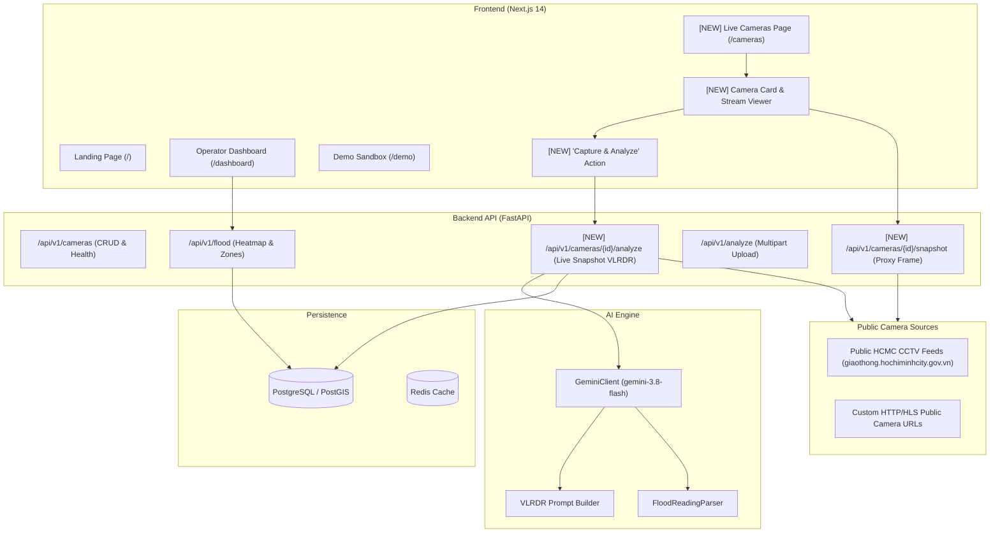

# Stage 2: Reverse Engineering — Architecture

## Current System Architecture vs Target Extension

### Key Architectural Enhancements
1. **Camera Frame Proxy & Ingestion**:
   - Web browsers encounter CORS limitations and mixed content restrictions when fetching public traffic CCTV streams directly.
   - The backend provides a secure asynchronous stream proxy (`GET /api/v1/cameras/{id}/snapshot`) using `httpx.AsyncClient` that caches frames with HTTP ETag / Cache-Control headers to optimize network bandwidth.
2. **One-Click Snapshot Analysis Endpoint**:
   - `POST /api/v1/cameras/{id}/analyze`: Grabs the latest frame from the camera's registered `stream_url`, invokes `GeminiClient` with the camera's specific `camera_angle` and `location_hint`, persists the `FloodReadingDB` record, updates the parent `FloodZone` depth level, and broadcasts the updated status.
3. **Dedicated Camera Observation Portal (`/cameras`)**:
   - Modern Next.js grid presenting public camera streams with auto-refresh timers, filter by district/zone, camera health indicators, and real-time modal display of AI VLRDR reasoning.
