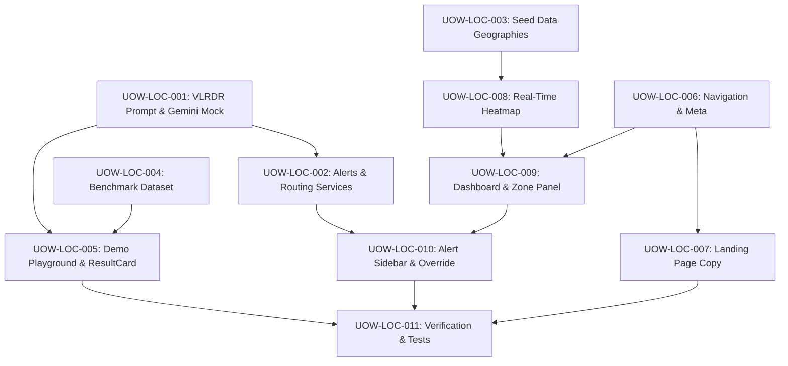

# FloodWheel — Unit of Work Dependencies

## Dependency Graph

## Execution Order
1. **Batch 1 (Backend Core & Prompts)**: `UOW-LOC-001`, `UOW-LOC-002`, `UOW-LOC-003`
2. **Batch 2 (Benchmark Data & Demo Sandbox)**: `UOW-LOC-004`, `UOW-LOC-005`
3. **Batch 3 (Frontend Shell & Marketing Pages)**: `UOW-LOC-006`, `UOW-LOC-007`
4. **Batch 4 (Operator Console & Alerts)**: `UOW-LOC-008`, `UOW-LOC-009`, `UOW-LOC-010`
5. **Batch 5 (Verification & Build Check)**: `UOW-LOC-011`
