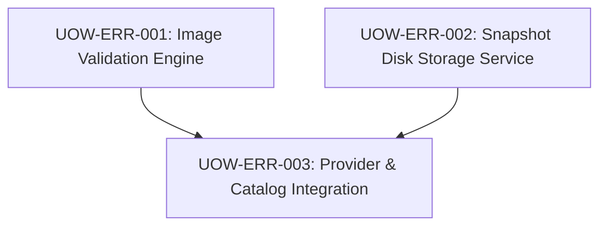

# FloodWheel — Unit of Work Dependency Graph

- **Execution Order**:
  1. `UOW-ERR-001` (can run independently or concurrently)
  2. `UOW-ERR-002` (can run independently or concurrently)
  3. `UOW-ERR-003` (depends on UOW-ERR-001 and UOW-ERR-002)
