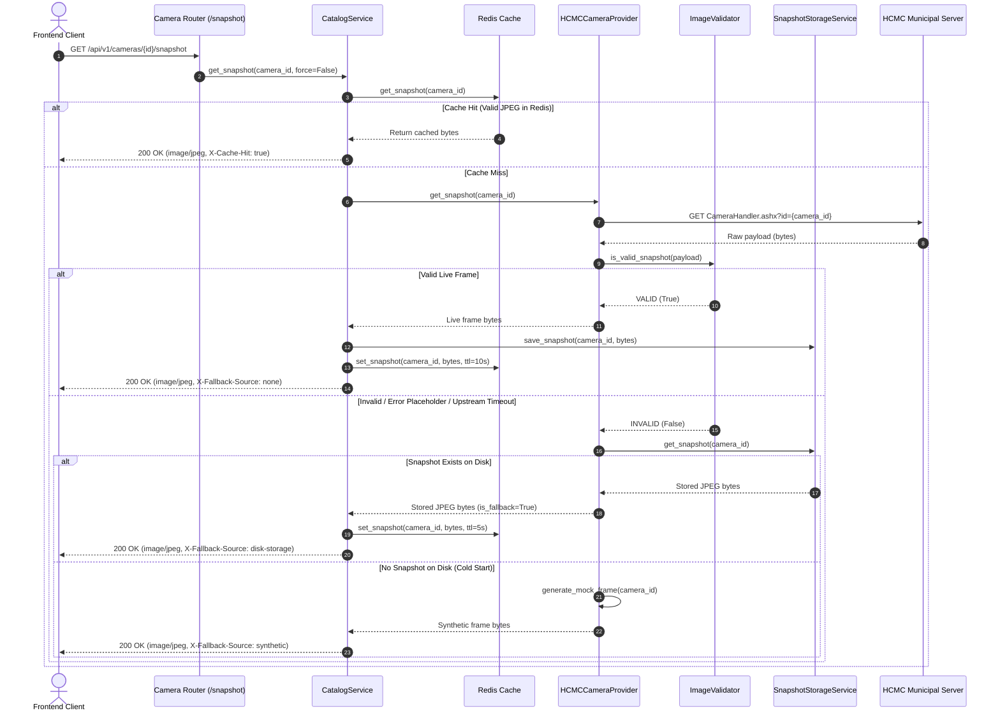

# FloodWheel — Functional Specification Document (FSD)

## 1. Scope & Objective
This specification defines the functional behavior of the snapshot validation, disk persistence, and fallback pipeline in `camera-backend`.

## 2. Process Flow

## 3. Storage Layer Specifications
- **Root Directory**: `storage/snapshots/` inside `camera-backend` container.
- **File Naming**: `{sanitized_camera_id}.jpg`.
- **Concurrency**: Write operations utilize temporary files (`{sanitized_camera_id}.tmp`) before atomically renaming to target `.jpg`.
- **Integrity Check**: On read, bytes are verified to have JPEG magic prefix (`\xff\xd8`).
