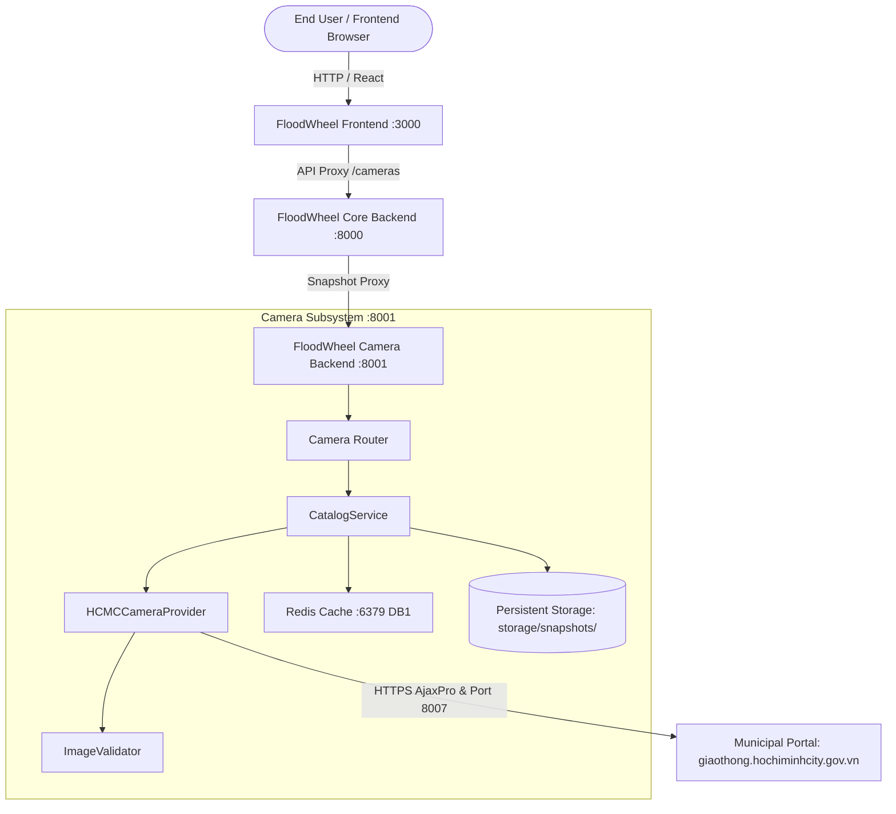

# FloodWheel — Current & Target Architecture

## 1. System Topology
FloodWheel runs a multi-service containerized architecture:

## 2. Component Roles
1. **Frontend (`frontend/` :3000)**:
   - Next.js / React map interface displaying CCTV pins and auto-refreshing snapshot popups.
   - Consumes `/api/v1/cameras/{id}/snapshot` from backend.
2. **Core Backend (`backend/` :8000)**:
   - FastAPI gateway handling GIS routing, flood prediction, and delegating camera requests to `camera-backend`.
3. **Camera Backend (`camera-backend/` :8001)**:
   - Dedicated microservice handling scrape orchestration, cookie authentication, image validation, disk persistence, and fallback generation.
4. **Redis (`redis:6379`)**:
   - DB 0: Core backend cache.
   - DB 1: Camera backend short-lived snapshot cache (TTL 10s) and session cookies (TTL 900s).
5. **Disk Storage (`storage/snapshots/`)**:
   - Local directory mounted inside `camera-backend` container holding `{camera_id}.jpg`.
   - Retains the most recent known-good valid snapshot for every camera.
