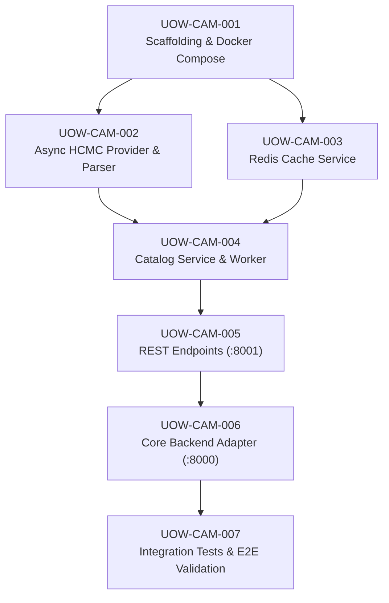

# Stage 7 — Units Generation: Unit of Work Dependencies

## Dependency Matrix

| Unit of Work | Depends On | Blocks | Rationale |
|---|---|---|---|
| `UOW-CAM-001` | None | `UOW-CAM-002`, `UOW-CAM-003` | Base project environment and dependencies must exist first. |
| `UOW-CAM-002` | `UOW-CAM-001` | `UOW-CAM-004` | Parser and provider supply raw data models. |
| `UOW-CAM-003` | `UOW-CAM-001` | `UOW-CAM-004` | Caching service required for storing tokens and snapshots. |
| `UOW-CAM-004` | `UOW-CAM-002`, `UOW-CAM-003` | `UOW-CAM-005` | Catalog coordinates provider and cache for query serving. |
| `UOW-CAM-005` | `UOW-CAM-004` | `UOW-CAM-006` | REST controllers expose the catalog to upstream callers. |
| `UOW-CAM-006` | `UOW-CAM-005` | `UOW-CAM-007` | Upstream backend consumes the exposed API. |
| `UOW-CAM-007` | `UOW-CAM-006` | None | Complete end-to-end integration and verification suite. |
