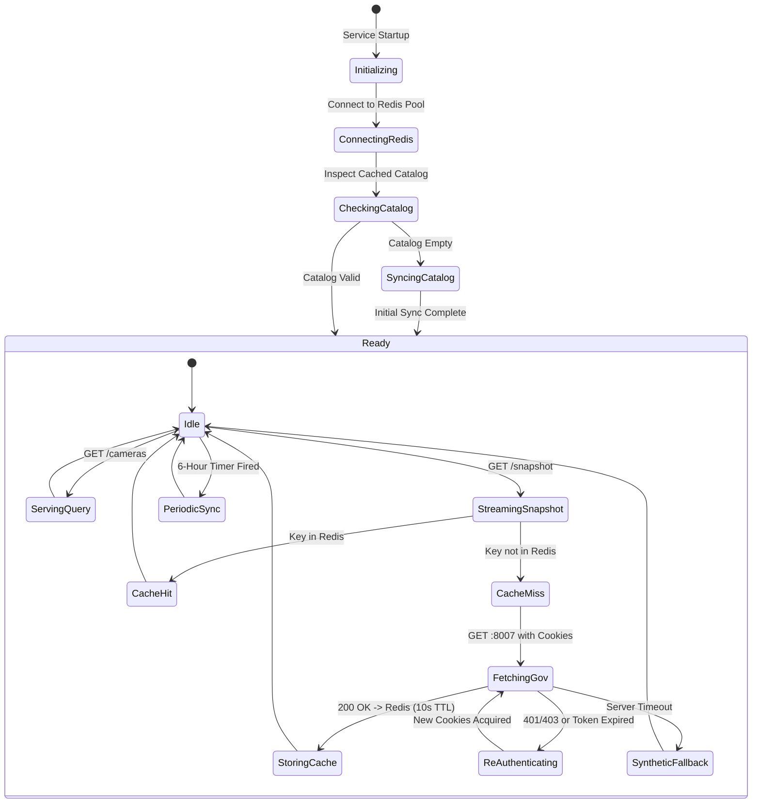

# Detailed Design Baseline: Dedicated Camera Management Backend (`camera-backend`)

## 1. System Context & Strategic Intent
FloodWheel's urban flood intelligence capabilities are significantly elevated by integrating Ho Chi Minh City's official municipal traffic surveillance camera network (~800 cameras from `giaothong.hochiminhcity.gov.vn`).

To maintain strict separation of concerns, high throughput, and zero downtime for AI inference and web map clients, all camera scraping, session management, catalog indexing, and JPEG snapshot caching are encapsulated into a dedicated microservice: `camera-backend` (port `8001`).

```mermaid
flowchart TD
    subgraph Clients ["Clients"]
        Browser["Next.js Web UI (:3000)"]
    end

    subgraph CorePlatform ["Core FloodWheel Platform"]
        CoreBackend["Core Backend FastAPI (:8000)"]
        Gemini["Gemini Vision AI (VLRDR Engine)"]
        Postgres[("PostgreSQL / PostGIS (:5432)")]
    end

    subgraph CameraService ["Camera Service (:8001)"]
        CameraSvc["FastAPI Camera Service"]
        Redis[("Redis 7 Cache (:6379)")]
        HCMCProv["HCMCCameraProvider"]
    end

    subgraph MunicipalGov ["HCMC Municipal Infrastructure"]
        GovPortal["giaothong.hochiminhcity.gov.vn"]
        GovRender["Port 8007 CameraHandler.ashx"]
    end

    Browser -->|API Calls| CoreBackend
    CoreBackend -->|VLRDR Prompts| Gemini
    CoreBackend -->|CRUD Readings & Zones| Postgres
    CoreBackend -->|CameraServiceClient (:8001)| CameraSvc

    CameraSvc -->|Snapshots & Cookies| Redis
    CameraSvc --> HCMCProv
    HCMCProv -->|AjaxPro SearchQuery| GovPortal
    HCMCProv -->|Stream Snapshots| GovRender
```

---

## 2. Component Ownership & Architecture

| Component | Repository Location | Primary Responsibility |
|---|---|---|
| **Microservice Application** | `camera-backend/app/main.py` | FastAPI server, lifespan events, CORS, dependency injection. |
| **Provider Abstraction** | `camera-backend/app/providers/base.py` | Abstract interface `BaseCameraProvider` for multi-city extensibility. |
| **HCMC Provider** | `camera-backend/app/providers/hcmc.py` | Scraper, stack token parser, cookie auto-reauthentication, snapshot proxy. |
| **Cache Engine** | `camera-backend/app/services/cache_service.py` | Redis client with binary byte caching (10s TTL) and cookie store (15m TTL). |
| **Catalog Service** | `camera-backend/app/services/catalog_service.py` | Multi-filter query engine (district, bbox, keyword) and background sync worker. |
| **REST Router** | `camera-backend/app/api/v1/` | Endpoints for `/cameras`, `/snapshot`, `/providers/hcmc/sync`, `/health`. |
| **Core Client Adapter** | `backend/app/services/camera_service_client.py` | Decoupled HTTP client connecting core backend to `camera-backend`. |

---

## 3. Data Models & API Contracts

### Data Model: `CameraDTO`
- `id` (str, primary identifier, e.g. `"662b86c41afb9c00172dd31c"`)
- `provider` (str, `"hcmc"`)
- `city` (str, `"hcmc"`)
- `name` (str, e.g. `"Ngã tư Hàng Xanh"`)
- `code` (str, e.g. `"CAM_HX_01"`)
- `district` (str, e.g. `"Bình Thạnh"`)
- `latitude` (float, WGS84)
- `longitude` (float, WGS84)
- `status` (str, `"UP"` | `"DOWN"`)
- `has_ptz` (bool)
- `snapshot_url` (str, internal relative proxy path)
- `live_video_url` (Optional[str])
- `last_synced_at` (datetime ISO 8601)

### Core REST Endpoints on `:8001`
1. `GET /api/v1/cameras`:
   - Filters: `city`, `district`, `keyword`, `bbox`, `status`, `limit`, `offset`.
2. `GET /api/v1/cameras/{id}`:
   - Full metadata object for a single camera.
3. `GET /api/v1/cameras/{id}/snapshot`:
   - Returns binary `image/jpeg` with `Cache-Control: public, max-age=10`.
4. `POST /api/v1/providers/{provider_name}/sync`:
   - Triggers manual sync on demand.
5. `GET /api/v1/health`:
   - Reports service, Redis, and provider telemetry.

---

## 4. State Transitions & Lifecycle



---

## 5. Security & SSRF Safeguards
1. **SSRF Prevention**: All external streaming or snapshot target URLs undergo strict host inspection blocking internal/private IP ranges (`127.0.0.1`, `localhost`, `10.0.0.0/8`, `172.16.0.0/12`, `192.168.0.0/16`, `169.254.0.0/16`).
2. **Session Token Isolation**: Cookies obtained from government portals are stored encrypted in Redis or private memory; they are never exposed to clients or in API responses.
3. **Pydantic Validation**: Strict bounding box ranges (`-90 <= lat <= 90`, `-180 <= lng <= 180`) and integer bounds on pagination parameters (`limit <= 1000`).

---

## 6. Failure & Recovery Strategy
- **Municipal Server Outage**: If `giaothong.hochiminhcity.gov.vn` or port `8007` goes offline, `camera-backend` returns an on-the-fly synthetic CCTV frame with real-time timestamp and location text, ensuring the frontend feed and AI analysis do not crash.
- **Redis Outage**: If Redis crashes, `CacheService` seamlessly activates an in-memory dictionary cache with TTL timestamps.
- **Core Backend Fallback**: If `camera-backend` is unreachable, `CameraServiceClient` logs a warning and falls back to local database cameras and mock frames without disrupting user navigation.

---

## 7. Test Design & Verification Matrix

| Test Suite | File | Target Coverage |
|---|---|---|
| **AjaxPro Stack Parser Test** | `camera-backend/tests/test_hcmc_parser.py` | 100% unit coverage of DataTable parsing, brackets handling, and WGS84 extraction. |
| **Redis Cache Test** | `camera-backend/tests/test_cache.py` | Binary JPEG caching, TTL expiration, and in-memory fallback. |
| **API Endpoints Test** | `camera-backend/tests/test_api.py` | Mocked HTTP responses for `GET /cameras`, `/snapshot`, `/health`. |
| **Core Client Integration Test** | `backend/tests/test_camera_service_integration.py` | Client adapter calling mock camera-backend server with circuit breaker. |

---

## 8. Requirements Traceability Matrix (RTM)

| Requirement | Title | Mapped User Story | Mapped Unit of Work | Baseline Status |
|---|---|---|---|---|
| **FR-CAM-01** | Modular Multi-Provider Architecture | `US-CAM-001` | `UOW-CAM-001` | Validated & Designed |
| **FR-CAM-02** | HCMC Provider & AjaxPro Parser | `US-CAM-002` | `UOW-CAM-002` | Validated & Designed |
| **FR-CAM-03** | Asynchronous Session & Cookie Manager | `US-CAM-002`, `US-CAM-003` | `UOW-CAM-003` | Validated & Designed |
| **FR-CAM-04** | Camera Catalog Query & Filter APIs | `US-CAM-002` | `UOW-CAM-004`, `UOW-CAM-005` | Validated & Designed |
| **FR-CAM-05** | Live Snapshot Streaming with Redis Cache | `US-CAM-003` | `UOW-CAM-003`, `UOW-CAM-005` | Validated & Designed |
| **FR-CAM-06** | Main Backend Integration Adapter | `US-CAM-004` | `UOW-CAM-006` | Validated & Designed |
| **FR-CAM-07** | Docker Compose & Health Probes | `US-CAM-001` | `UOW-CAM-001`, `UOW-CAM-007` | Validated & Designed |
| **NFR-CAM-01** | Sub-15ms Query Latency & Caching | `US-CAM-003` | `UOW-CAM-003`, `UOW-CAM-004` | Validated & Designed |
| **NFR-CAM-02** | Fault Tolerance & Fallback Frames | `US-CAM-003` | `UOW-CAM-002`, `UOW-CAM-006` | Validated & Designed |
| **NFR-CAM-03** | SSRF Security & Input Sanitization | `US-CAM-001` | `UOW-CAM-001`, `UOW-CAM-005` | Validated & Designed |
| **NFR-CAM-04** | Multi-City Provider Extensibility | `US-CAM-001` | `UOW-CAM-002` | Validated & Designed |

---

## 9. Baseline Approval & Construction Transition
- **Baseline Date**: `2026-10-10T14:45:00+07:00`
- **Execution Mode**: Autonomous Mode (Auto-Approve & Auto-Resolve)
- **Status**: **APPROVED & BASELINED**
- **Ready for Construction Phase**: The project is fully specified and ready to transition into the **Construction Phase** for implementation across Phases 1, 2, and 3 (`UOW-CAM-001` through `UOW-CAM-007`).
