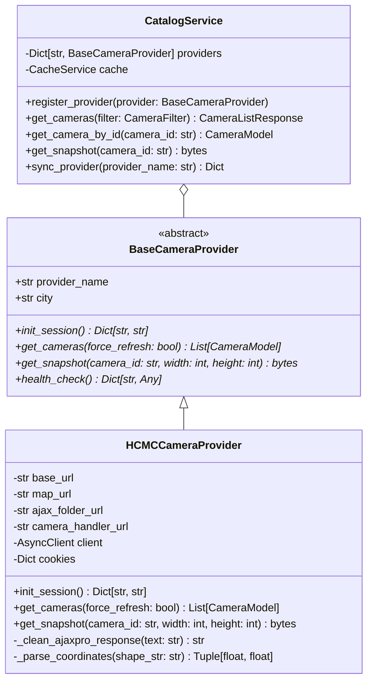

# Stage 3 — Functional Specification Document (FSD)

## 1. System Scope & Domain Model

The `camera-backend` microservice acts as an abstraction gateway for real-time traffic camera networks. It ingests, normalizes, indexes, and streams video snapshot data to FloodWheel's core backend and interactive dashboards.

### Domain Entity: `CameraModel`
```json
{
  "id": "string (UUID or Provider ID)",
  "provider": "string (e.g. 'hcmc')",
  "city": "string (e.g. 'hcmc')",
  "name": "string (e.g. 'Vòng xoay Dân Chủ - Cách Mạng Tháng 8')",
  "code": "string (e.g. 'CAM_Q3_DC01')",
  "district": "string (e.g. 'Quận 3')",
  "latitude": 10.7781,
  "longitude": 106.6823,
  "status": "string ('UP' | 'DOWN' | 'MAINTENANCE')",
  "has_ptz": true,
  "camera_type": "string ('PTZ' | 'FIXED')",
  "snapshot_url": "string (/api/v1/cameras/{id}/snapshot)",
  "live_video_url": "string (optional HLS .m3u8)",
  "last_synced_at": "datetime (ISO 8601)",
  "metadata": "object (raw provider attributes)"
}
```

---

## 2. API Specifications & Error Handling

### 2.1 `GET /api/v1/cameras`
- **Purpose**: Lists cameras matching query filters.
- **Request Parameters**:
  - `city`: String (default: `"hcmc"`).
  - `district`: String (e.g. `"Quận 1"`, `"Bình Thạnh"`).
  - `keyword`: String (searches in `name`, `code`, `district`).
  - `bbox`: String (`"min_lat,min_lng,max_lat,max_lng"`).
  - `status`: String (`"UP"` | `"DOWN"` | `"ALL"`).
  - `limit`: Integer (1..1000, default: 50).
  - `offset`: Integer (>= 0, default: 0).
- **Response**: `200 OK` with `{ "total": int, "limit": int, "offset": int, "items": CameraModel[] }`.

### 2.2 `GET /api/v1/cameras/{camera_id}/snapshot`
- **Purpose**: Retrieves real-time JPEG snapshot frame.
- **Request Parameters**:
  - `w`: Integer (optional, 160..1920).
  - `h`: Integer (optional, 120..1080).
  - `force_refresh`: Boolean (default: `false`).
- **Response Headers**:
  - `Content-Type: image/jpeg`
  - `Cache-Control: public, max-age=10`
  - `X-Cache: HIT | MISS`
  - `X-Camera-ID: {camera_id}`
- **Fallback**:
  - If external provider times out or returns HTTP error, responds with HTTP 200 OK containing synthetic CCTV image with timestamp overlay.

### 2.3 `POST /api/v1/providers/{provider_name}/sync`
- **Purpose**: Triggers an on-demand catalog extraction and refresh.
- **Path Parameter**: `provider_name` (e.g., `"hcmc"`).
- **Response**:
  ```json
  {
    "provider": "hcmc",
    "status": "success",
    "synced_count": 782,
    "duration_seconds": 2.14,
    "timestamp": "2026-10-10T14:38:00Z"
  }
  ```

---

## 3. Provider Architecture Specification


