# Stage 5 — Workflow Planning: Construction Execution Plan

## 1. Architectural Strategy & Phased Roadmap

```mermaid
flowchart LR
    subgraph Phase1 ["Phase 1: Microservice Scaffolding & Provider Engine"]
        UOW1["UOW-CAM-001<br/>Microservice Scaffolding & Docker Compose"]
        UOW2["UOW-CAM-002<br/>Async HCMC Provider & AjaxPro Stack Parser"]
        UOW3["UOW-CAM-003<br/>Redis Caching & Session Token Manager"]
    end

    subgraph Phase2 ["Phase 2: Catalog Management & REST Endpoints"]
        UOW4["UOW-CAM-004<br/>Camera Catalog Service & Background Worker"]
        UOW5["UOW-CAM-005<br/>REST Endpoints (:8001) & Health Probes"]
    end

    subgraph Phase3 ["Phase 3: Core Backend Integration & Validation"]
        UOW6["UOW-CAM-006<br/>CameraServiceClient in Core Backend (:8000)"]
        UOW7["UOW-CAM-007<br/>End-to-End Verification & Gemini VLRDR Pipeline"]
    end

    UOW1 --> UOW2
    UOW2 --> UOW3
    UOW3 --> UOW4
    UOW4 --> UOW5
    UOW5 --> UOW6
    UOW6 --> UOW7
```

---

## 2. Construction Phases Breakdown

### Phase 1: Microservice Scaffolding & Provider Engine (11 Story Points)
- **Goal**: Establish the standalone `camera-backend` microservice container, modular provider interface, async HCMC AjaxPro parser, and Redis caching.
- **Units of Work**:
  - `UOW-CAM-001`: Create `camera-backend/` project structure, `Dockerfile`, `requirements.txt`, and update `docker-compose.yml` with port 8001. (3 pts)
  - `UOW-CAM-002`: Implement `BaseCameraProvider` abstract class and `HCMCCameraProvider` porting logic from `hcmc_traffic_cameras.py` using async HTTPX. (5 pts)
  - `UOW-CAM-003`: Implement `CacheService` for Redis session cookies and 10s snapshot TTL with in-memory fallback. (3 pts)

### Phase 2: Catalog Management & REST Endpoints (9 Story Points)
- **Goal**: Implement persistent camera catalog management, periodic background sync, and expose clean REST API endpoints on port 8001.
- **Units of Work**:
  - `UOW-CAM-004`: Implement `CatalogService` with in-memory/persistent catalog index, district filtering, bbox filtering, and background synchronization worker. (4 pts)
  - `UOW-CAM-005`: Implement FastAPI controllers for `GET /api/v1/cameras`, `GET /api/v1/cameras/{id}`, `GET /api/v1/cameras/{id}/snapshot`, and `POST /api/v1/providers/hcmc/sync`. (5 pts)

### Phase 3: Core Backend Integration & Verification (8 Story Points)
- **Goal**: Connect FloodWheel's core backend to `camera-backend` via an async client adapter and verify end-to-end flood depth analysis.
- **Units of Work**:
  - `UOW-CAM-006`: Implement `CameraServiceClient` in `backend/app/services/camera_service_client.py` and update `backend/app/routers/cameras.py`. (5 pts)
  - `UOW-CAM-007`: Automated integration tests, mocking external government endpoints, and validating the Gemini Vision VLRDR pipeline with live camera snapshots. (3 pts)

**Total Scope**: 3 Phases, 7 Units of Work, 28 Story Points.
