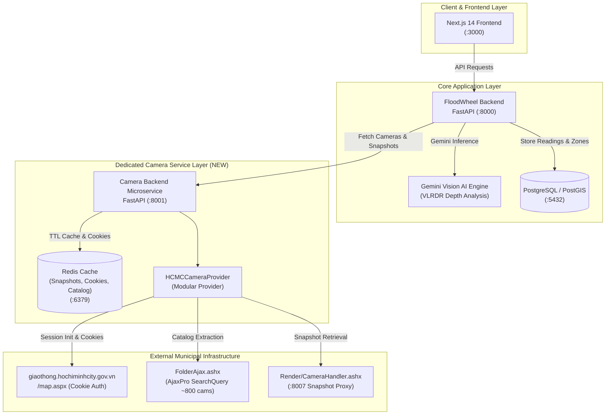

# Stage 2 — Reverse Engineering: Architecture

## 1. System Topology & Transition Overview

## 2. Ingestion & Communication Dataflow

### Flow A: Camera Catalog Synchronization
1. `CameraBackend` initiates or schedules periodic sync (e.g., every 6 hours or upon admin POST `/api/v1/providers/hcmc/sync`).
2. `HCMCCameraProvider` establishes a session with `https://giaothong.hochiminhcity.gov.vn/map.aspx`, receiving required auth cookies (`.VDMS`, `ASP.NET_SessionId`, `_frontend`, `TS01e7700a`).
3. Provider executes AjaxPro `SearchQuery` request to `FolderAjax,VDMS.Web.Library.ashx`.
4. The raw JavaScript response containing `new Ajax.Web.DataTable(...)` is parsed via a balanced-bracket token scanner and converted to structured camera entities.
5. Geo-coordinates (`POINT(lng lat)`) and metadata (districts, status, stream URLs) are normalized into standard Pydantic schemas and cached in Redis/local persistent store.

### Flow B: Live Snapshot Request & AI Depth Analysis
1. Client (Frontend or Background Poller) requests snapshot or analysis from `MainBackend`.
2. `MainBackend` calls `CameraServiceClient.get_snapshot(camera_id)`.
3. `CameraBackend` checks Redis cache (`snapshot:{camera_id}`).
   - **Cache Hit**: Returns cached JPEG immediately (sub-10ms latency).
   - **Cache Miss**: Acquires fresh JPEG from `https://giaothong.hochiminhcity.gov.vn:8007/Render/CameraHandler.ashx?id={camera_id}&bg=black` using active authenticated cookies, stores in Redis with a 5-15s TTL, and streams to `MainBackend`.
4. `MainBackend` pipes the JPEG buffer into Gemini Vision API for VLRDR flood reasoning, generating depth estimates and passability alerts.
