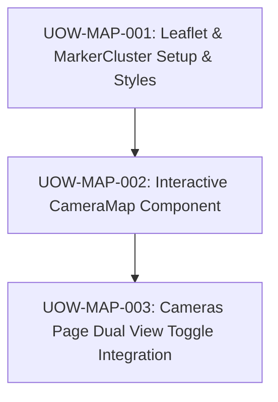

# FloodWheel — Unit of Work Dependency Graph

- **Execution Flow**:
  1. `UOW-MAP-001`: Configure package dependencies and CSS files.
  2. `UOW-MAP-002`: Build standalone `CameraMap` component.
  3. `UOW-MAP-003`: Wire `CameraMap` into `frontend/pages/cameras.tsx` with view toggle.
