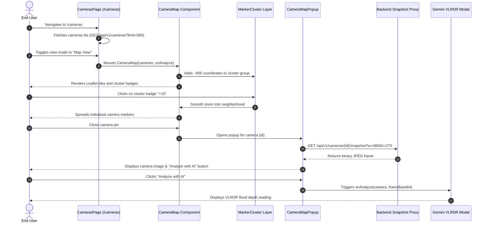

# FloodWheel — Functional Specification Document (FSD): Camera Map

## 1. User Interaction Flow

## 2. Marker Representation
- **Cluster Badge**:
  - Small (< 10 cams): Emerald badge `w-9 h-9`, ring-emerald-400.
  - Medium (10–50 cams): Blue badge `w-10 h-10`, ring-blue-400.
  - Large (> 50 cams): Purple/Indigo badge `w-12 h-12`, ring-indigo-400.
- **Individual Pin**:
  - Custom SVG camera icon inside circular badge with glowing pulse dot.
  - Emerald dot for `ONLINE`, amber dot for `OFFLINE`.
