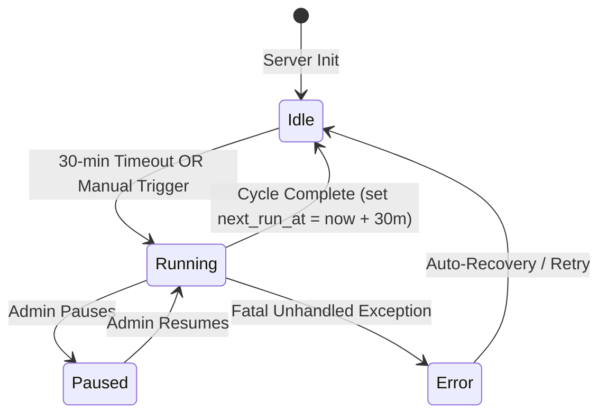

# Services Specification — Automated 30-Minute AI Analysis & Admin Monitor

## 1. Background Queue Service (`FloodAnalysisQueue`)
- **Location**: `backend/app/services/flood_queue_service.py`
- **Pattern**: Asynchronous Background Worker with Event-Driven Waking
- **State Machine**:

## 2. Flood Analysis Service (`FloodAnalysisService`)
- **Location**: `backend/app/services/flood_analysis_service.py`
- **Pattern**: Domain Orchestrator with Multi-Tier Fallback
- **Performance Optimizations**:
  - Immediate skip for default placeholder frames (0ms delay).
  - Short-circuit cache verification (reuses recent AI reading within TTL).
  - Isolated database sessions per camera to prevent transaction contamination.

## 3. Gemini Client (`GeminiClient`)
- **Location**: `backend/app/services/gemini_client.py`
- **Pattern**: Multi-Key Rate-Limiting Connection Pool with Lock Guard
- **Concurrency & Pacing**:
  - Global `asyncio.Lock` ensures single-stream invocation per key.
  - Rate-limit spacing ensures minimum interval compliance (1.5s - 2.5s safe pacing for Gemini Flash).
