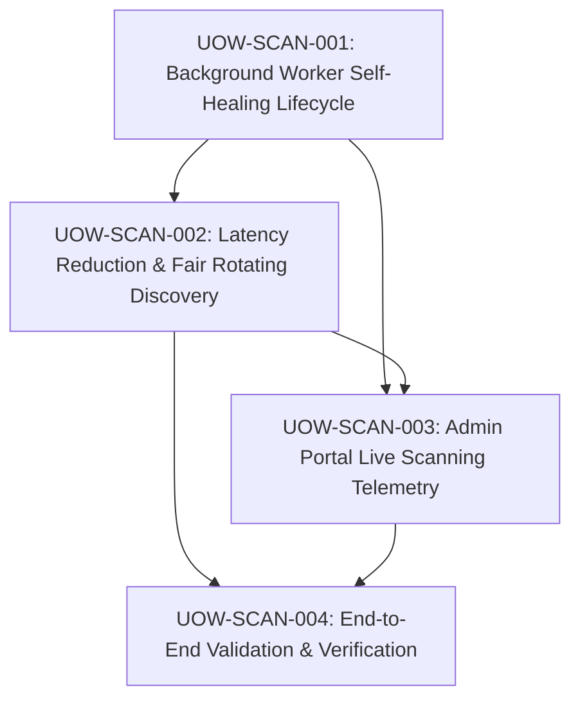

# Unit of Work Dependency — Automated 30-Minute AI Analysis & Admin Monitor

## Execution Order
1. **`UOW-SCAN-001`**: Establish rock-solid worker lifecycle, auto-start on trigger, and exception recovery in the backend.
2. **`UOW-SCAN-002`**: Eliminate redundant delays, add fair rotating discovery, and optimize HTTP timeouts.
3. **`UOW-SCAN-003`**: Build rich live monitor, countdown timer, progress bar, and controls on `/admin`.
4. **`UOW-SCAN-004`**: Verify end-to-end execution, measure cycle duration, and ensure zero regressions.
