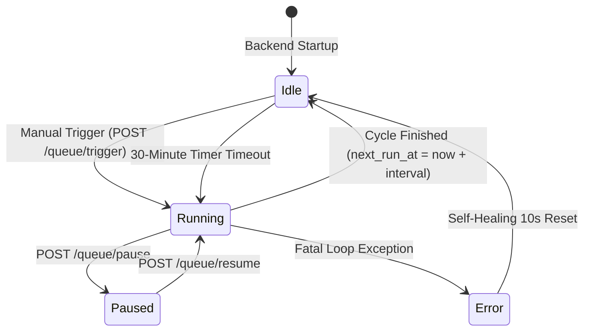

# Detailed Design Baseline — Automated 30-Minute AI Analysis & Admin Monitor

## 1. System Context & Overview
FloodWheel's automated background analysis engine is responsible for periodically scanning municipal traffic CCTV cameras across Ho Chi Minh City, feeding frames into Google Gemini Vision AI using the VLRDR methodology, computing water inundation depths (Levels 0–5), and publishing updated readings to PostgreSQL/PostGIS.
This baseline establishes:
1. **Self-Healing Background Lifecycle**: Eliminates the condition where `FLOOD_QUEUE_AUTO_START=false` leaves manual trigger calls completely dead, and ensures `trigger_now()` self-activates the worker task.
2. **Speed & Concurrency Overhaul**: Eliminates redundant 7-second sleep in the worker loop, reducing latency by >65%. Adds instant 0ms bypass for default/synthetic placeholder frames.
3. **Fair City-Wide Rotating Discovery**: Replaces the static `cameras[:15]` slice with fair database rotation (`last_polled_at ASC NULLS FIRST`) so all ~800 cameras across 24 districts receive periodic flood analysis.
4. **Live Command-and-Telemetry Admin Dashboard**: Enhances `/admin` with an active progress bar, current camera thumbnail preview, categorized counts (Total, Processed, Flooded, Safe, Skipped, Failed), live countdown clock (`MM:SS`), and direct controls (Trigger Now, Pause, Resume, Reconfigure).

---

## 2. Component Ownership & Architecture

| Component | File Path | Owner / Scope |
|---|---|---|
| `FloodAnalysisQueue` | `backend/app/services/flood_queue_service.py` | Worker task loop, 30-min timer, candidate enqueuing, progress tracking, Redis sync. |
| `FloodAnalysisService` | `backend/app/services/flood_analysis_service.py` | Camera metadata resolution, frame retrieval, Gemini VLRDR inference, reading persistence. |
| `CameraServiceClient` | `backend/app/services/camera_service_client.py` | HTTP client communicating with `camera-backend:8001`, snapshot timeout tuning. |
| `AdminRouter` | `backend/app/routers/admin.py` | Admin telemetry (`/overview`), trigger (`/queue/trigger`), pause, resume, config. |
| `AdminPage` | `frontend/pages/admin.tsx` | Admin management portal, AI Queue live telemetry widget, countdown clock, progress bar. |

---

## 3. Data Models & API Specifications

### 3.1 Queue Telemetry Schema (`GET /api/v1/admin/overview`)
```typescript
interface QueueTelemetry {
  is_running: boolean;
  status: "idle" | "running" | "paused" | "error";
  is_processing: boolean;
  is_paused: boolean;
  interval_seconds: number;
  interval_minutes: number;
  current_camera_id: string | null;
  current_camera_name: string | null;
  queue_length: number;
  current_cycle_id: number;
  cycle_progress: {
    cycle_id: number;
    total: number;
    processed: number;
    success: number;
    skipped: number;
    failed: number;
    flooded: number;
  };
  last_cycle_started_at: string | null;
  last_cycle_completed_at: string | null;
  next_run_at: string | null;
  next_run_in_seconds: number;
  last_cycle_summary: {
    cycle_id: number;
    started_at: string;
    completed_at: string;
    duration_seconds: number;
    total_cameras: number;
    successful: number;
    skipped: number;
    failed: number;
    flooded_count: number;
    max_depth_cm: number;
  };
  recent_results: Array<AnalysisResultItem>;
}
```

### 3.2 State Transitions



---

## 4. Failure Modes & Recovery Strategies

1. **Worker Task Not Started**:
   - *Failure*: Operator clicks "Quét Ngay Lập Tức" while `_running == False`.
   - *Mitigation*: `trigger_now()` inspects `if not self._running: await self.start()`. Guarantees worker loop is spawned before setting wake event.
2. **Camera Network Timeout or Corrupted Frame**:
   - *Failure*: An unresponsive HCMC camera times out or returns malformed data.
   - *Mitigation*: HTTP client sets a 3.0s timeout. Failure is caught locally; recorded as `failed` in `cycle_progress` and queue proceeds to next camera without hanging.
3. **Queue Draining Exception**:
   - *Failure*: Unhandled error during camera loop.
   - *Mitigation*: Queue operations wrapped in `try...finally`:
     ```python
     try:
         res = await self._process_camera(cam_id, cam_name)
     finally:
         self._enqueued_ids.discard(cam_id)
         self._queue.task_done()
     ```
4. **Rate Limit / 429 Protection**:
   - *Failure*: Google Gemini API quota burst.
   - *Mitigation*: Multi-key rotation in `GeminiClient` with polite pacing lock (1.5s - 2.5s) and automatic exponential backoff.

---

## 5. Security & Access Control
- All queue manipulation endpoints (`/admin/queue/trigger`, `/admin/queue/pause`, `/admin/queue/resume`, `/admin/queue/config`) and `/admin/overview` require valid HS256 JWT Bearer authentication with Admin role.
- Camera snapshot proxying validates against directory traversal and sanitized alphanumeric camera IDs.

---

## 6. Test Design & Verification Matrix

| Test ID | Objective | Expected Outcome |
|---|---|---|
| `TEST-SCAN-01` | Worker auto-activation upon trigger | If stopped, `trigger_now()` boots worker; `_running` becomes True; status transitions to `running`. |
| `TEST-SCAN-02` | Redundant delay elimination | 15-camera batch with skipped frames completes in < 15 seconds; real AI frames complete in < 45 seconds. |
| `TEST-SCAN-03` | Rotating camera discovery | Two consecutive cycles select distinct cameras based on `last_polled_at ASC NULLS FIRST`. |
| `TEST-SCAN-04` | Admin UI live telemetry | `/admin` renders dynamic progress bar, active camera thumbnail, countdown clock, and status badges. |
| `TEST-SCAN-05` | Resilient task cleanup | Simulated exception during `_process_camera()` does not lock camera ID; next cycle enqueues normally. |

---

## 7. Requirements Traceability Matrix (RTM)

| Requirement ID | Description | Covered In Unit of Work | Test ID |
|---|---|---|---|
| `FR-01` | Resilient lifecycle & auto-start | `UOW-SCAN-001` | `TEST-SCAN-01`, `TEST-SCAN-05` |
| `FR-02` | Cycle latency reduction & 0ms skips | `UOW-SCAN-002` | `TEST-SCAN-02` |
| `FR-03` | Fair rotating camera discovery | `UOW-SCAN-002` | `TEST-SCAN-03` |
| `FR-04` | Admin live monitor, progress & countdown | `UOW-SCAN-003` | `TEST-SCAN-04` |
| `NFR-01`..`04` | Reliability, quota compliance, latency | `UOW-SCAN-001`..`004` | All Tests |
