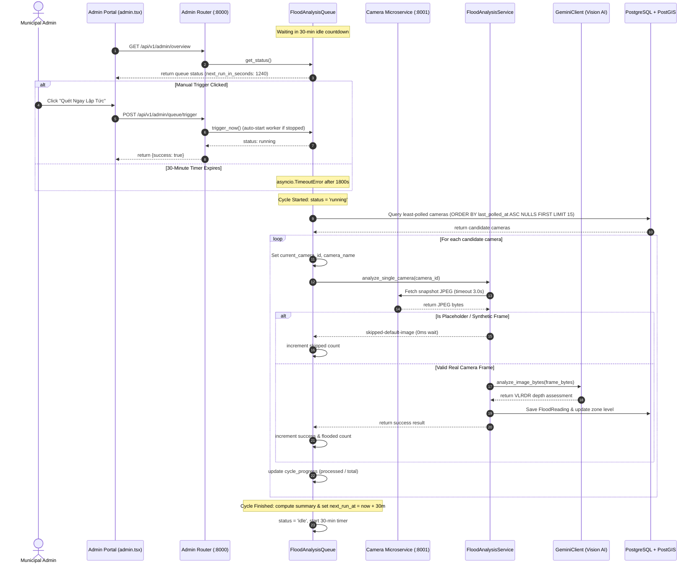
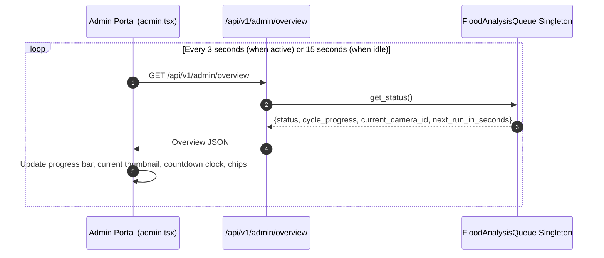

# Functional Specification Document (FSD) — Automated 30-Minute AI Analysis & Admin Monitor

## 1. System Interaction & Lifecycle Sequences

### Sequence 1: Scheduled & Manual Analysis Lifecycle

### Sequence 2: Admin Live Telemetry Polling Loop

## 2. Admin UI Telemetry Widget Specification

### 2.1 State-Driven Telemetry Header
- **Running State (`status == "running"`)**:
  - Banner color: Indigo / Blue with animated pulse.
  - Heading: "ĐANG TIẾN HÀNH QUÉT PHÂN TÍCH TỰ ĐỘNG (CHU KỲ #X)".
  - Progress bar: Striped blue/indigo with percentage label (`X% - Đã xử lý Y / Z camera`).
  - Active Camera Card: Displays camera thumbnail image (`/api/v1/cameras/{id}/snapshot`), camera name, district, and camera angle.
  - Stat Chips:
    - 🔵 Tổng camera: Z
    - ⏳ Đang xử lý: Y/Z
    - 🌊 Phát hiện ngập: F
    - 🟢 An toàn: S
    - ⚪ Bỏ qua (ảnh lỗi/placeholder): K
    - 🔴 Thất bại: E
- **Idle State (`status == "idle"`)**:
  - Banner color: Emerald / Slate.
  - Heading: "HÀNG ĐỢI SẴN SÀNG — ĐỢT QUÉT TIẾP THEO SAU: MM:SS".
  - Countdown Clock: Large monospace font `28:45` updating every second.
  - Scheduled time badge: `Dự kiến: 20:15:30 (sau 28 phút 45 giây)`.
  - Last Cycle Card: Displays duration in seconds, total cameras polled, flood instances detected, max depth in cm.
- **Paused State (`status == "paused"`)**:
  - Banner color: Amber.
  - Heading: "HÀNG ĐỢI ĐANG TẠM DỪNG".
  - Action button: "Tiếp tục chạy (Resume)".
- **Error State (`status == "error"`)**:
  - Banner color: Rose.
  - Heading: "HÀNG ĐỢI GẶP SỰ CỐ".
  - Display error details and "Khởi động lại ngay (Restart)".

### 2.2 Direct Queue Controls
- **Quét Ngay Lập Tức (Trigger Now)**: Issues `POST /api/v1/admin/queue/trigger`. Fast feedback toast.
- **Tạm Dừng / Tiếp Tục (Pause / Resume)**: Issues `POST /api/v1/admin/queue/pause` or `/resume`.
- **Cấu hình hàng đợi (Queue Configuration Modal / Drawer)**:
  - Input: Khoảng cách chu kỳ quét (mặc định 30 phút, tối thiểu 5, tối đa 120).
  - Input: Số lượng camera tối đa mỗi đợt quét (mặc định 15, tối thiểu 5, tối đa 50).
  - Save button issuing `PATCH /api/v1/admin/queue/config`.
