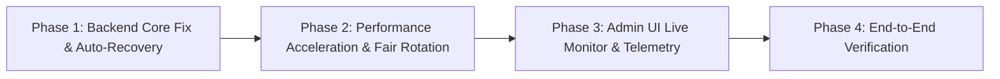

# Execution Plan — Automated 30-Minute AI Analysis & Admin Monitor

## Phase Strategy

### Phase 1: Backend Core Fix & Auto-Recovery (`UOW-SCAN-001`)
- **Focus**: Resilient lifecycle, self-healing start upon trigger, robust exception recovery in `FloodAnalysisQueue`.
- **Key Changes**:
  - Auto-start background worker if inactive on `/admin/queue/trigger` and `trigger_now()`.
  - Wrap queue draining and task completion in `try...finally` to avoid locked camera IDs.
  - Fix crash state handling with auto-recovery back to idle instead of getting stuck in `error`.

### Phase 2: Performance Acceleration & Fair Rotation (`UOW-SCAN-002`)
- **Focus**: Eliminate double sleep delays, bounded concurrent snapshot retrieval, fair least-recently-polled camera rotation.
- **Key Changes**:
  - Remove redundant 7s sleep inside the queue worker; unify Gemini pacing.
  - Instant zero-delay skip on default/synthetic placeholder frames.
  - Implement dynamic rotating discovery using `last_polled_at ASC NULLS FIRST` across all monitored cameras.
  - Add bounded-concurrency pre-fetching for candidate camera snapshots with strict 3.0s timeout.

### Phase 3: Admin UI Live Monitor & Telemetry (`UOW-SCAN-003`)
- **Focus**: Comprehensive scanning monitor dashboard widget in `frontend/pages/admin.tsx`.
- **Key Changes**:
  - Live animated progress bar (percentage and processed/total count).
  - Active scanning camera card (name, ID, district, and live snapshot thumbnail).
  - Metric breakdown chips (Total, Processed, Flooded, Safe, Skipped, Failed).
  - Next-run live countdown clock (`MM:SS`) and exact target timestamp.
  - Summary card of last completed run.
  - Queue configuration modal/inputs for interval and batch size.
  - Fast-polling interval (3s when active, 15s when idle).

### Phase 4: End-to-End Verification (`UOW-SCAN-004`)
- **Focus**: Integration testing, manual verification, lint check, and load test simulation.
- **Key Changes**:
  - Verify manual trigger starts queue immediately and executes all 15 cameras within < 60s.
  - Verify countdown timer decrements smoothly.
  - Verify next scheduled cycle fires automatically after 30 minutes.
  - Verify UI shows correct badges and thumbnails.
