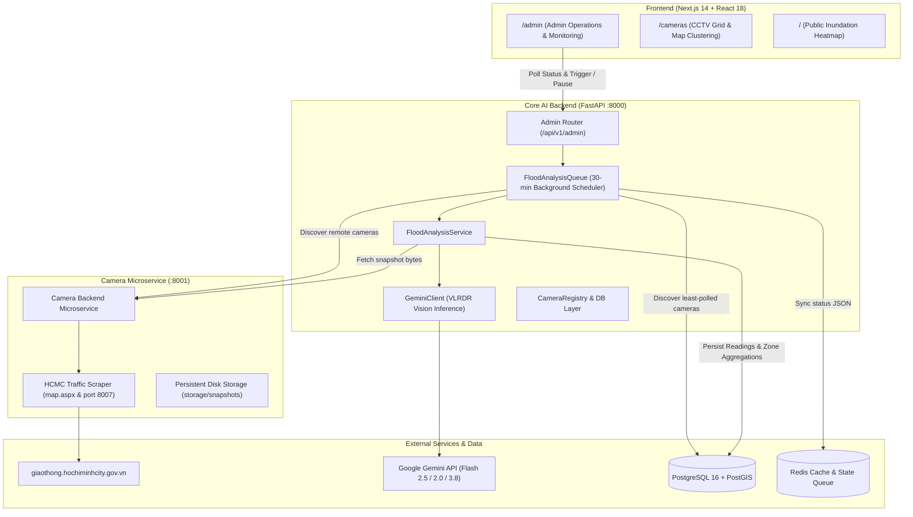

# Architecture — FloodWheel

## System Architecture Diagram

## Subsystem Details
1. **Frontend**: Next.js 14 with TypeScript and Tailwind CSS. Communicates via REST APIs with HS256 JWT Bearer authentication for administrator operations.
2. **Backend**: FastAPI with async SQLAlchemy (asyncpg), Pydantic v2 validation, and async background tasks.
3. **Queue Service (`FloodAnalysisQueue`)**: Singleton background worker running an infinite loop with `asyncio.sleep` / `asyncio.Event` synchronization for scheduled execution.
4. **Camera Microservice (`camera-backend`)**: Independent service managing ~800 HCMC CCTV streams with cookie session maintenance and persistent JPEG storage fallback.
