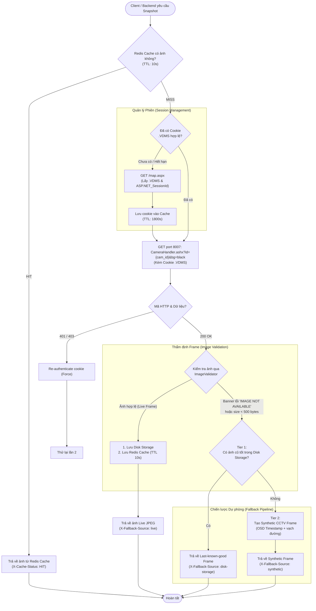
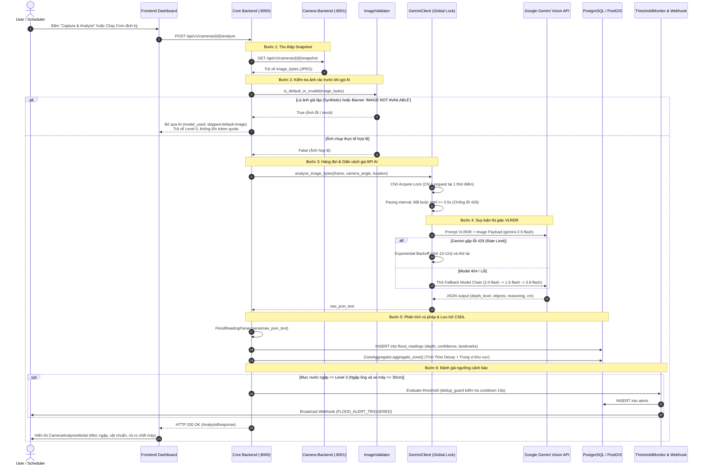

# Kiến Trúc & Quy Trình Kéo Ảnh Camera và Phân Tích Mực Nước Bằng AI (FloodWheel)

Tài liệu chi tiết phân tích logic, luồng dữ liệu (data flow) và kiến trúc thực thi của tính năng **kéo ảnh camera giao thông (Pull Image)** và **phân tích ngập lụt bằng Gemini Vision AI (VLRDR methodology)** trong hệ thống FloodWheel.

---

## 1. Tổng Quan Kiến Trúc (Architecture Overview)

Hệ thống được tổ chức theo mô hình Microservices tách biệt giữa hạ tầng CCTV và logic nghiệp vụ AI:

```
+-----------------------------------------------------------------------------------+
|                                 Next.js Frontend                                  |
|            (Live Map, Camera Catalog, 1-Click Capture & Analyze, Alert Modal)     |
+-----------------------------------------------------------------------------------+
                       |                                         |
     (GET /api/v1/cameras, /snapshot)                (POST /analyze, /analyze-batch)
                       v                                         v
+----------------------------------------------+   +--------------------------------+
|          Camera-Backend (:8001)              |   |       Core Backend (:8000)     |
| - HCMC Municipal Portal Scraper (.VDMS)     |<--| - CameraServiceClient Adapter   |
| - Redis Snapshot Cache (TTL: 10s)            |   | - ImageValidator (Pre-filter)  |
| - 2-Tier Fallback (Disk -> Synthetic CCTV)   |   | - GeminiClient (Lock & Pacing) |
+----------------------------------------------+   | - VLRDR Prompt Builder         |
                                                   | - FloodReadingParser           |
                                                   | - ZoneAggregator (Time Decay)  |
                                                   | - ThresholdMonitor & Alert Webhook
                                                   +--------------------------------+
                                                                 |
                                                                 v
                                                   +--------------------------------+
                                                   |   PostgreSQL + PostGIS & Redis |
                                                   +--------------------------------+
```

---

## 2. Luồng Kéo Ảnh Camera (Camera Image Pull Flow)

Camera được tích hợp trực tiếp từ Cổng thông tin giao thông TP. Hồ Chí Minh (`giaothong.hochiminhcity.gov.vn`). Quá trình kéo ảnh bảo đảm tính liên tục (high availability) nhờ bộ đệm Redis và cơ chế dự phòng 2 tầng.

### 2.1 Sơ đồ luồng (Flowchart)



### 2.2 Các bước xử lý chi tiết

1. **Quản lý phiên xác thực (`init_session`)**:
   - Gửi GET request đến `https://giaothong.hochiminhcity.gov.vn/map.aspx`.
   - Trích xuất cookie xác thực định danh `.VDMS` và `ASP.NET_SessionId`.
   - Lưu trữ vào Redis với TTL là 30 phút (`SESSION_COOKIE_TTL_SECONDS = 1800`).
2. **Kéo dữ liệu danh mục camera (`get_cameras`)**:
   - Gửi payload JSON đến endpoint AjaxPro `FolderAjax.ashx`.
   - Parse định dạng đặc thù .NET `new Ajax.Web.DataTable(...)` thành JSON chuẩn.
   - Trích xuất tọa độ không gian từ `POINT(lng lat)` sang `(latitude, longitude)`.
3. **Kéo ảnh Snapshot trực tiếp (`get_snapshot`)**:
   - Gửi request đến `http://giaothong.hochiminhcity.gov.vn:8007/CameraHandler.ashx?id={camera_id}&bg=black`.
   - Gửi kèm session cookie `.VDMS`.
4. **Thẩm định & Lọc lỗi (`ImageValidator`)**:
   - So khớp MD5/SHA-256 đối với các banner lỗi thông dụng từ máy chủ thành phố (`IMAGE NOT AVAILABLE`).
   - Kiểm tra magic bytes binary (`\xff\xd8` cho JPEG).
5. **Cơ chế Fallback 2 tầng (2-Tier Resilient Fallback)**:
   - **Tier 1 (Disk Storage)**: Nếu camera upstream mất mạng hoặc trả banner lỗi, hệ thống đọc frame hợp lệ gần nhất đã lưu trong thư mục `storage/snapshots/{camera_id}.jpg`.
   - **Tier 2 (Synthetic Mock Generator)**: Nếu chưa từng có frame hợp lệ nào được lưu, hệ thống tự động sinh một khung hình độ tương phản cao giả lập đường phố đô thị, có thanh OSD hiển thị tên camera, timestamp UTC chuẩn.

---

## 3. Luồng Phân Tích Mực Nước Bằng AI (AI Flood Analysis Workflow)

Hệ thống sử dụng mô hình đa phương thức đa tầng **Google Gemini Vision** kết hợp phương pháp luận thị giác **VLRDR (Visual Landmark Relative Depth Reasoning)**.

### 3.1 Sơ đồ tuần tự (Sequence Diagram)



### 3.2 Các bước xử lý chi tiết

1. **Khởi phát phân tích**:
   - **Thao tác thủ công**: Người dùng nhấn "Capture & Analyze" trên thẻ camera hoặc bản đồ (`POST /api/v1/cameras/{id}/analyze`).
   - **Hàng đợi ngầm (`FloodAnalysisQueue`)**: Quét tuần tự danh sách camera đang hoạt động; mỗi chu kỳ hoàn thành sẽ nghỉ 30 phút trước khi bắt đầu chu kỳ tiếp theo.
2. **Tiền xử lý & Thẩm định tải trọng (`ImageValidator`)**:
   - Nếu camera đang mất kết nối và chỉ trả về ảnh giả lập hoặc banner lỗi, hệ thống đánh dấu trạng thái `skipped-default-image` và **không gửi payload lên Gemini**. Điều này giúp loại bỏ 100% chi phí token lãng phí vào ảnh không có giá trị thực tế.
3. **Cơ chế điều tiết gọi API AI (`GeminiClient`)**:
   - **Global Lock (`asyncio.Lock`)**: Đảm bảo toàn hệ thống chỉ có đúng 1 yêu cầu suy luận AI được xử lý đồng thời.
   - **Pacing Interval an toàn (`GEMINI_MIN_CALL_INTERVAL_SECONDS = 6.0s`)**: Áp dụng thời gian chờ cưỡng bức tối thiểu 6.0 giây giữa 2 lượt gọi liên tiếp nhằm khống chế tần suất tối đa $\approx 10\text{ RPM}$, luôn nằm dưới ngưỡng an toàn 15 RPM của Google Gemini.
   - **Xoay vòng đa khóa API (Multi-key Rotation & 429 Failover)**: Cấu hình danh sách nhiều key qua `GEMINI_API_KEYS`. Khi một key chạm quota (429), key đó lập tức vào trạng thái cooldown 30s và hệ thống tự động tráo sang key tiếp theo trong pool.
   - **Bộ nhớ đệm thông minh (Smart Analysis Cache)**: Tái sử dụng kết quả trong vòng 5 phút (`FLOOD_ANALYSIS_CACHE_MINUTES = 5`), trả về kết quả `cache-hit` tức thì với 0 token tiêu thụ.
   - **Giới hạn chu kỳ nền**: Background Queue chỉ quét tối đa 15 camera ưu tiên mỗi chu kỳ (`FLOOD_QUEUE_MAX_CAMERAS_PER_CYCLE = 15`) và mặc định tắt tự chạy (`FLOOD_QUEUE_AUTO_START = false`) để bảo toàn quota ngày (1,500 RPD).
   - **Chuỗi mô hình dự phòng (Model Fallback Chain)**:
     $$\text{gemini-2.5-flash} \longrightarrow \text{gemini-2.0-flash} \longrightarrow \text{gemini-1.5-flash} \longrightarrow \text{mock-vlrdr-engine}$$
4. **Phương pháp suy luận vật chuẩn thị giác VLRDR (`VLRDRPromptBuilder`)**:
   - Thay vì cảm biến thủy văn chôn dưới nước, AI sử dụng kích thước vật lý của các phương tiện và hạ tầng giao thông đô thị Việt Nam làm thước đo:
     - **Xe máy (Honda Wave, Vision, Air Blade)**: Đường kính bánh xe $\approx 50\text{ cm}$.
     - **Ống xả xe máy**: Cao $\approx 30\text{ - }35\text{ cm}$ so với mặt đường.
     - **Gờ bó vỉa hè tiêu chuẩn**: Cao $\approx 15\text{ cm}$.
     - **Gờ dải phân cách giữa tim đường**: Cao $\approx 20\text{ - }25\text{ cm}$.
     - **Bệ bước chân ô tô con (sedan)**: Cao $\approx 25\text{ - }30\text{ cm}$.
5. **Chuẩn hóa & Làm sạch dữ liệu (`FloodReadingParser`)**:
   - Loại bỏ markdown wrapper (```json).
   - Kiểm tra tính hợp lệ của `depth_level` (0 đến 5), `depth_estimate_cm_min`, `depth_estimate_cm_max`, `confidence_score` (0.0 đến 1.0) và mảng `reference_objects_used`.
6. **Tổng hợp khu vực theo trọng số suy giảm thời gian (`ZoneAggregator`)**:
   - Dữ liệu quá 15 phút: Giảm 30% trọng số tin cậy.
   - Dữ liệu quá 25 phút: Giảm 60% trọng số tin cậy.
   - Tính toán mức ngập đại diện của khu vực bằng trung vị có trọng số (weighted median).
7. **Giám sát ngưỡng & Phát tán cảnh báo (`ThresholdMonitor` & `DeduplicationGuard`)**:
   - Nếu mức ngập $\ge 3$ (nguy hiểm, ngập ống bô xe máy):
     - Kiểm tra bộ chống lặp `dedup_guard`: Cooldown 15 phút cho cùng một khu vực và mức ngập.
     - Tạo bản ghi trong bảng `alerts`.
     - Bắn Webhook sự kiện `FLOOD_ALERT_TRIGGERED` đến các bên tích hợp.

---

## 4. Bảng Tham Chiếu Thước Đo Thị Giác VLRDR

| Cấp ngập | Độ sâu ước tính | Dấu hiệu vật chuẩn đường phố (Landmarks) | Khả năng di chuyển & Khuyến cáo |
| :---: | :---: | :--- | :--- |
| **Level 0** | `0 cm` | Mặt đường khô hoặc chỉ ướt bóng nước phản chiếu, không đọng nước | An toàn cho tất cả phương tiện |
| **Level 1** *(Chú ý)* | `5 - 15 cm` | Ngập dưới 1/3 bánh xe máy, mấp mé mép gờ bó vỉa hè | Phương tiện lưu thông bình thường |
| **Level 2** *(Cảnh báo)* | `15 - 30 cm` | Nước ngập nửa bánh xe máy, ngập gờ dải phân cách, sát mép dưới ống bô | Xe máy đi chậm ở tim đường; chú ý sóng nước |
| **Level 3** *(Nguy hiểm)* | `30 - 45 cm` | **Ống xả xe máy ngập chìm**, nước ngập nửa bánh xe sedan | **Xe máy chết máy**; ô tô sedan nguy cơ thủy kích |
| **Level 4** *(Nghiêm trọng)*| `45 - 70 cm` | Bánh xe máy ngập hoàn toàn, nước tràn qua bệ bước và cửa ô tô sedan | Đường tê liệt; chỉ xe tải lớn/xe gầm rất cao đi được |
| **Level 5** *(Thảm họa)* | `> 70 cm` | Nước ngập ngang yên xe máy, ngập nắp ca-pô ô tô, xe trôi/bỏ lại | Đường bị chia cắt hoàn toàn; cấm lưu thông |

---

## 5. Danh Mục Mã Nguồn Trọng Tâm (Source Code Map)

| Thành phần | Đường dẫn tệp | Trách nhiệm chính |
| :--- | :--- | :--- |
| **HCMC Provider** | `camera-backend/app/providers/hcmc.py` | Quản lý session `.VDMS`, cào danh mục camera, kéo snapshot cổng 8007 |
| **Camera Endpoints** | `camera-backend/app/api/v1/endpoints/cameras.py` | API tra cứu camera, proxy snapshot và gắn cờ cache Redis |
| **Storage Service** | `camera-backend/app/services/storage_service.py` | Lưu trữ và truy xuất snapshot hợp lệ gần nhất trên ổ cứng |
| **Client Adapter** | `backend/app/services/camera_service_client.py` | Adapter kết nối từ core backend sang camera-backend |
| **Image Validator** | `backend/app/services/image_validator.py` | Phát hiện ảnh banner lỗi MD5/SHA256 và nhận diện ảnh synthetic |
| **Analysis Orchestrator** | `backend/app/services/flood_analysis_service.py` | Điều phối chụp ảnh, gọi AI, phân tích kết quả và cập nhật vùng ngập |
| **Gemini Client** | `backend/app/services/gemini_client.py` | Quản lý Global Lock, pacing delay 3.5s, multi-model fallback chain |
| **VLRDR Prompt** | `backend/app/services/vlrdr_prompt.py` | Xây dựng prompt hướng dẫn AI đo đạc theo vật chuẩn giao thông VN |
| **Result Parser** | `backend/app/services/flood_reading_parser.py` | Làm sạch JSON, validate schema và chuẩn hóa độ sâu |
| **Zone Aggregator** | `backend/app/services/zone_aggregator.py` | Tổng hợp trung vị mức ngập của khu vực theo hệ số suy giảm thời gian |
| **Threshold Monitor** | `backend/app/services/threshold_monitor.py` | Kiểm tra ngưỡng nguy hiểm ($\ge \text{Level 3}$) và phát tán webhook |
| **Dedup Guard** | `backend/app/services/dedup_guard.py` | Chống gửi trùng lặp cảnh báo trong cửa sổ cooldown 15 phút |
| **Queue Scheduler** | `backend/app/services/flood_queue_service.py` | Lập lịch quét tự động định kỳ với chu kỳ nghỉ 30 phút giữa các lượt |
